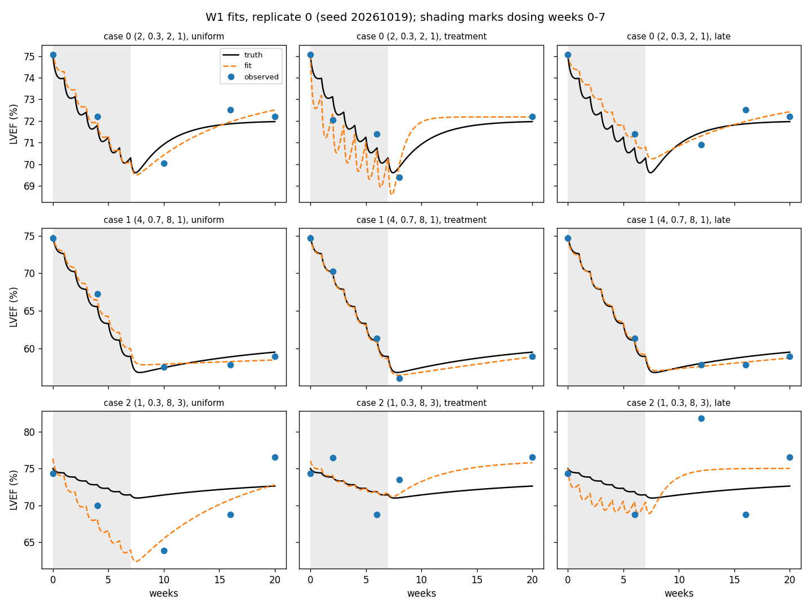

# Week 1 (Oct 19-23): minimal end-to-end script

Owner: Xinan. Task from the proposal: a roughly 150-line script that simulates,
adds noise and does a bounded grid fit with a fixed seed.

```
python scripts/W1.py
```

It takes about 3 seconds on my laptop. It writes two files to `outputs/`:

- `W1_fits.csv`: one row per fit. The first line has the seed and settings.
- `W1_fits.png`: truth, noisy observations and the fitted curve for
  replicate 0 of every case/schedule pair (3 x 3 panels).

Both are in the repo, so you can look at them without running anything:



## What the script does

1. **Simulate.** It uses the recovery + persistence model from the proposal,
   `L(t) = L0 - b_R * G_k(t) - b_P * H(t)`, with the closed-form H and G_k.
   The setup is eight weekly doses of 0.625 (1.25 mg/kg over the 2 mg/kg
   reference) at weeks 0-7, tau = 0.25 weeks and L0 = 75.
2. **Add noise.** Gaussian noise with SD 1 or 3 is added. The noise is drawn once
   on all visit times together, so the three schedules see the same noise draw
   and the comparison between them is paired.
3. **Fit.** For a fixed k the model is linear in (L0, b_R, b_P). So at each of 60
   log-spaced k values (half-life 0.1 to 52 weeks) I solve a bounded linear
   least-squares problem with `scipy.optimize.lsq_linear`, then keep the k with
   the lowest RSS. The bounds are L0 in [50, 95] and b_R, b_P in [0, 6].
4. **Report.** For each fit it saves the estimates and the normalized
   amplitude error. It also sets three flags:
   - `k_unidentifiable`: b_R ended up at 0, so k has no effect on the fit.
   - `k_at_grid_edge`: the best k is at the end of the grid.
   - `coef_at_bound`: a coefficient sits on one of its bounds.

Scope is kept to what the proposal asks for in the pilot:

| case | a | f_P | recovery half-life (wk) | noise SD |
|---|---|---|---|---|
| 0 | 2 | 0.3 | 2 | 1 |
| 1 | 4 | 0.7 | 8 | 1 |
| 2 | 1 | 0.3 | 8 | 3 |

| schedule | visits (weeks, 0 = baseline) |
|---|---|
| uniform | 0, 4, 10, 16, 20 |
| treatment | 0, 2, 6, 8, 20 |
| late | 0, 6, 12, 16, 20 |

`N_REPS` is 3 for now, only to check that everything runs. Diya's Week 4
comparison will use 20.

## A note on k * tau = 1

The G_k formula has `1 - k*tau` in the denominator. With tau = 0.25 that hits
zero at k = 4/week, i.e. a half-life of about 0.17 weeks. That is inside our
grid, so I couldn't leave it for later. I rewrote the term with `d = 1/tau - k`
so it goes smoothly to the proposal's `(s/tau) exp(-s/tau)` limit, and used
`np.expm1` so it stays accurate when d is tiny. The derivation is in the
`basis()` docstring.

## What the first run shows

With seed 20261019, replicate 0:

```
case  schedule   b_R true/fit   b_P true/fit   half-life true/fit   loss   flags
   0  uniform     1.40 / 1.22    0.60 / 0.37     2.00 / 5.61          0.011
   0  treatment   1.40 / 5.78    0.60 / 0.57     2.00 / 0.61          2.395
   1  uniform     1.20 / 0.96    2.80 / 2.54     8.00 / 52.00         0.004  k-at-grid-edge
   2  late        0.70 / 6.00    0.30 / 0.00     8.00 / 1.03         14.090  at-bound: b_R b_P
   ...
```

The estimates move around a lot. I don't think this is a bug. Baseline plus
four visits gives 5 points for 4 parameters, so there is only one residual
degree of freedom. Case 2 has the smallest effect and the largest noise, so it
is the worst. In case 1 the half-life runs to the 52-week edge on all three
schedules. That is the "persistent vs. very slow recovery" problem the proposal
warns about. Three replicates are too few to say which schedule is better. That
is the Week 4 job.

## Things I'm not sure about (to ask at the meeting)

- Weeks 2, 4 and 6 are both visit weeks and dose weeks. In the script the dose
  given at time t adds nothing at that same instant, so the visit is effectively
  measured just *before* that week's dose. Is that the convention we want?
- The k grid is coarse: neighbouring half-lives differ by about 11%. So the
  true values 2 and 8 weeks are not exactly on the grid. The proposal mentions
  refining the profile later; I haven't done that yet.
- sigma is not estimated anywhere yet. The fit just minimizes RSS.

## Next (Week 2)

Pull the simulator into its own function/module and add unit tests (zero dose,
zero amplitudes), and write down the input/output shapes. The Week 1 script
should keep running while that happens.
