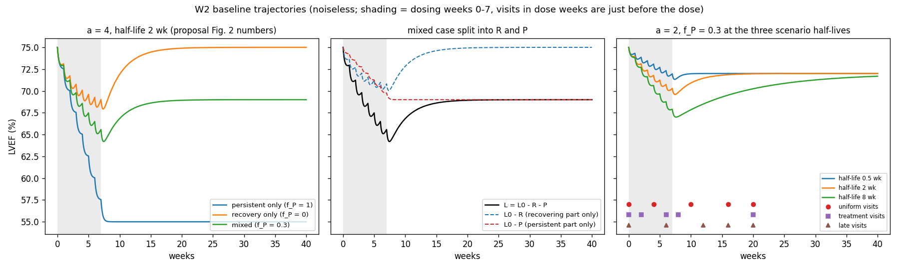

# Week 2 (Oct 26-30): baseline simulator + unit tests

Owner: Xinan. My task from the proposal: "Add a baseline simulator with unit
tests for zero dose and zero amplitudes; document input and output shapes." Our
shared output for the week is "model notes from the joint session and tested
baseline trajectories."

I also did the Week 1 follow-ups from the Oct 29 reply (see `W1.md`).

## Short version

- The model now lives in a small package:
  - `src/doxo_lvef/inputs.py`: dosing, E(t), visit times, reading the config
  - `src/doxo_lvef/models.py`: the recovery + persistence model
  - `src/doxo_lvef/identifiability.py`: `profile_interval`, which decides what
    the RSS profile says about the half-life
- `configs/pilot.toml` holds the pilot settings (except `N_REPS`, which is still
  in W1), including the visit convention.
- 149 tests, all passing. `python -m pytest` takes about 10 seconds.
- `scripts/W2.py` draws the noiseless baseline trajectories.
- `scripts/W1.py` still runs and gives the same fitted numbers as in Week 1 (the
  only thing it takes from the package is `profile_interval`). `test_config.py`
  checks that W1's H and G_k match the package's bit for bit.

## How to run

From the repo root, with the venv active:

```
pip install -r requirements.txt     # pytest was added this week
python -m pytest                    # runs everything in tests/
python scripts/W2.py                # makes outputs/W2_trajectories.png
python scripts/W1.py                # W1 fits and figure
```

## What's in the package

I only made the modules we need right now. `fit.py`, `design.py` and
`evaluate.py` from the proposal's list come later. There's no noise helper yet
either; W1 does its own, and I'll add a proper one with the Week 4 seed work.

### `inputs.py`: what we know before fitting

| function | what it does |
|---|---|
| `Dosing(times, q, tau)` | the treatment history. Checks that times are sorted, doses aren't negative, tau > 0 and there's no NaN. It keeps its own read-only copy of the arrays |
| `weekly_dosing(dose_mg_per_kg, n_doses, first_dose_week=0, interval_weeks=1, reference_mg_per_kg=2, tau_weeks=0.25)` | regular schedule; 1.25 mg/kg / 2 gives q = 0.625 |
| `no_dosing(tau_weeks=0.25)` | no treatment at all (used in the zero-dose test) |
| `effective_input(t, dosing)` | E(t), the drug input in normalized dose per week |
| `visit_times(schedule, offset_weeks=0, first_dose_week=0)` | turns a schedule into float visit times; the offset moves follow-ups only |
| `check_times(t)` | makes t a 1-D float array, rejects 2-D input and NaN/inf |
| `load_config(path=None)`, `dosing_from_config(cfg)` | read `configs/pilot.toml` (or another TOML file) |

### `models.py`: the baseline model

| function | what it does |
|---|---|
| `response_basis(t, k, dosing)` | returns H(t) and G_k(t), so L = L0 - b_R G_k - b_P H |
| `simulate_lvef(t, L0, b_R, b_P, k, dosing)` | noiseless LVEF |
| `simulate_states(t, L0, b_R, b_P, k, dosing)` | R, P and L separately (handy for plots and checks) |
| `params_from_case(a, f_P, half_life_weeks, L0=75)` | b_R = a(1 - f_P), b_P = a f_P, k = ln 2 / half-life. Rejects a negative, NaN or infinite a, f_P outside [0, 1], and a half-life that isn't a finite positive number |

### `identifiability.py`: what the data can say about the half-life

| function | what it does |
|---|---|
| `profile_interval(half_lives, rss, sigma, level=0.95, at_cap=None)` | takes the RSS profile over the half-life grid and returns the label (`identified`, `lower bound only`, `upper bound only`, `disjoint`, `not identified`) and the nominal 95% interval ends. A side doesn't count as closed if its first ruled-out point is the grid's own end or has its fit on a cap. Bad input (unsorted grid, NaN, sigma <= 0...) is a ValueError |

### Input and output shapes

The proposal asked me to write these down. Basically: you pass time in as one
1-D array and everything you get back has that same length.

| argument / return | type and shape | units |
|---|---|---|
| `t` | float, list or 1-D array, shape `(n_t,)`. A single float counts as `(1,)`. 2-D or NaN/inf gives a ValueError | weeks |
| `Dosing.times` | 1-D array `(n_doses,)`, sorted, can be empty | weeks |
| `Dosing.q` | 1-D array `(n_doses,)`, >= 0 | normalized dose (mg/kg / 2) |
| `Dosing.tau` | float > 0 | weeks |
| `k` | one number >= 0, turned into a plain float (k = 0 gives G = H). An array is a ValueError | per week |
| `L0`, `b_R`, `b_P` | floats | pp, and pp per normalized dose |
| `H`, `G` (returned) | 1-D arrays `(n_t,)` | normalized dose |
| `R`, `P`, `L` (returned) | 1-D arrays `(n_t,)` | pp |
| `effective_input` (returned) | 1-D array `(n_t,)` | normalized dose per week |
| `visit_times` (returned) | float array `(n_visits,)`, baseline first | weeks |
| `profile_interval`: `half_lives`, `rss`, `at_cap` | 1-D arrays `(n_grid,)`, `half_lives` strictly increasing, `at_cap` bools | weeks, pp^2 |
| `profile_interval` (returned) | dict: `status`, `low`, `high` (weeks or None), `low_set_by_cap`, `high_set_by_cap`, `disjoint`, `threshold`, `delta` and `inside` (arrays `(n_grid,)`) | |

Inside `response_basis` I build an `(n_t, n_doses)` matrix of "time since each
dose" and sum over the doses, which is why everything comes back as `(n_t,)`.

## The tests

`python -m pytest` runs 149 tests in six files:

- `test_models.py` (46): the two the proposal asks for (zero dose, done two
  ways, and zero amplitudes both keep LVEF exactly at L0), shapes and bad input,
  the closed form actually solving the ODEs (a finite-difference check), the
  plateaus (the mixed case lands at 69%, the same as the proposal's Figure 2,
  which was a nice cross-check), k = 0 giving G = H, the k*tau = 1 limit, huge k
  staying finite, and the visit convention.
- `test_inputs.py` (24): the dose normalization, bad dosing, E(t) (including
  area under E = total dose), and visit times.
- `test_identifiability.py` (30): the half-life labels on made-up profiles where
  we know the answer, including the grid-end and cap rules on both sides, and bad
  input.
- `test_w1_fit.py` (33): W1's labels on real fits, mostly noiseless data where we
  know the answer. For example, a = 4, f_P = 0.3, half-life 2 is identified at
  sigma = 0.25 but only gets an upper bound at sigma = 1, because of the b_R cap.
  Also what gets printed and plotted, and the error checks.
- `test_config.py` (9): the config and W1 agree, and the package's H and G_k
  match W1's bit for bit out to week 300.
- `test_scripts.py` (7): both scripts run, including as a real
  `python scripts/W1.py` command, and W1 still reproduces the committed CSV.

I also broke the code on purpose in a throwaway copy (wrong cutoff, swapped
interval ends, ignoring caps, R and P swapped, and so on) to make sure the tests
notice, and added tests whenever a break got through. Now every break I tried
makes at least one test fail, except two that can't change anything: removing
W1's own sigma check (`profile_interval` rejects a bad sigma with the same
error), and `s > 0` instead of `s >= 0` in `models.py` (H and G add exactly 0 at
s = 0 either way).

### A real bug the tests found

My first version wrote G as `exp(-k*s) * (1 - exp(-d*s)) / d` with
`d = 1/tau - k`. When k > 1/tau (half-life under about 0.17 weeks), d is
negative. Then the second exp grows, overflows to inf, and gets multiplied by
the first one, which has underflowed to 0. That gives NaN, with only a warning.

For the pilot it only shows up far outside what we use: for half-life 0.1 weeks
it appears around week 242, and for 0.02 weeks around week 23. Nothing we run
gets near that (the Week 3 refinement stays between grid neighbours), but
`response_basis` takes any k >= 0 and shouldn't quietly return NaN. I fixed it
by pulling out the slower of the two decay rates first (`m = min(k, 1/tau)`,
`d = |1/tau - k|`). It's the same formula, but now no exponent is ever positive.
I checked that the old and new versions agree to about 1e-16 wherever the old
one worked. W1 uses the same form (its numbers didn't change), so the two agree
bit for bit.

### A mistake in my own test

One of my tests failed the first time, and it was the test's fault, not the
model's. I was checking "area under E = total dose" with the trapezoid rule,
with each interval ending exactly on the next dose time. Right at t_j, E already
includes the new dose's spike (q/tau = 2.5), because the code counts a dose as
given when s = 0. So the area came out about 0.0004 too big. Stopping just
before each dose fixed it. Later I switched that test to `quad`. This is the same
s = 0 thing the Oct 29 reply brought up, but from the other side: H and G add
exactly 0 at s = 0, which is why the "just before the dose" visits work, but E
already jumps there. I wrote this down in the `effective_input` docstring,
since the Week 3 `solve_ivp` code will run into it.

## The figure



What I see in it:
- Left panel: these use the proposal's Figure 2 numbers (a = 4, half-life 2
  weeks). Persistent-only drops to 55 and stays there. Recovery-only goes back
  to 75. Mixed settles at 69. The script prints these, and they match
  L0 - b_P x 5 to the two decimals it prints. Recovery-only is still about 1e-4
  short at week 40.
- Middle panel: the mixed curve split into its two parts. The lowest point is
  64.2, at about week 7.4. The climb back up after that is all R recovering
  (the blue dashed line goes back to 75). P just stays where it is once dosing
  stops.
- Right panel: this one matters most for picking visit weeks. The settings are
  a = 2 and f_P = 0.3, so the plateau is 72.
  - The 0.5-week half-life curve is flat at 72 by about week 10. R halves every
    3.5 days, so it's gone fast.
  - The 2-week curve gets there around weeks 16-20.
  - The 8-week curve is still at 70.25 at week 20 and 71.7 at week 40.

  So at week 20, the 0.5- and 2-week curves are basically the same (72.0 vs
  71.97). Only visits during dosing or soon after can tell those two apart: at
  week 6 they're 72.3 vs 70.8. Telling the 8-week one apart from "it just stays
  down" needs late visits. That's also why the 52-week edge kept showing up in
  the Week 1 fits.

## Still open

- The model notes from the joint session aren't written yet, since we haven't
  had the session. Until then the model, its closed form and the k*tau = 1
  rewrite are in the `models.py` docstrings.
- The shared source-access log and data dictionary aren't in this repo yet.
- Things I still need to figure out: how big a bump between two local minima
  makes them "separate" for the second-minimum rule, whether "failed" should
  mean bvls status <= 0 or a non-finite RSS, and whether the final evaluation
  gets its own config file.

## Next (Week 3)

- Add the numerical path (`solve_ivp`, integrating piecewise between doses) and
  tests comparing it with the closed form.
- Turn the W1 grid fit into a bounded fitting interface in `fit.py`. It returns
  the full RSS profile, the coefficients at every k and the cap flags, and gets
  a real "failed" status plus what the Oct 29 reply asked for: the refinement
  rule (I'll refine the minimum first, then the interval ends), the
  second-minimum rule and a refinement test on a noiseless case.
- My simulator gets reviewed this week, so I'll fix what the review finds first.
- Write the joint-session model notes once we've had the session.
