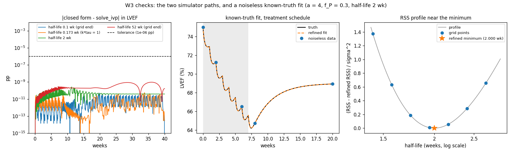

# Week 3 (Nov 2-6): simulator check + fitting interface

Owner: Xinan. My task from the proposal: "Implement the analytical and numerical
paths, repeated-rate handling and bounded fitting interface. Add automated
comparison tests." Our shared output for the week is the analytical-versus-numerical
verification and one known-truth fit, and the readiness check is "The simulator
agrees within tolerance; one command reproduces a fit."

The Oct 29 reply added three things for this week:
- integrate piecewise between doses in the `solve_ivp` path, and handle the s = 0
  term consistently;
- build the refinement rule into the fitting interface;
- add one test showing that refinement moves the half-life by less than one grid
  step on a noiseless case.

The Nov 8 reply then set how a fit gets reported. The fitting interface follows
that too.

## Short version

- `models.simulate_states_ode` solves the two ODEs with `solve_ivp`, piecewise
  between doses. Over the whole half-life grid, k*tau = 1 and k = 0, it matches
  the closed form to 2.6e-9 percentage points (my tolerance is 1e-6 pp).
- `src/doxo_lvef/fit.py` is the fitting interface, `fit_lvef`.
  - With `refine=False` (the default) it's W1's grid fit, and it gives the same
    fits as W1 on all 27 W1 datasets.
  - With `refine=True` it adds the refinement from the Oct 29 reply.
  - Every fit comes with its 95% profile-likelihood set and that set's class
    (`identified`, `open above`, `open below` or `uninformative`), any bound hits,
    and the fitted nadir depth.
- On the noiseless test case, refinement moves the half-life from 1.945 to 2.000
  weeks (0.26 grid steps) and gets the true L0, b_R, b_P and nadir depth back.
- `python scripts/W3.py` runs both checks and saves `outputs/W3_check.png`.
- 178 tests, all passing (29 new). W1's and W2's outputs didn't change.

## How to run

From the repo root, with the venv active:

```
python -m pytest            # all tests, about 15 seconds
python scripts/W3.py        # the two checks, makes outputs/W3_check.png
```

## Analytical vs numerical

`simulate_states_ode(t, L0, b_R, b_P, k, dosing)` returns the same R, P and L as
`simulate_states`, but from `solve_ivp` instead of the closed form:

- One `solve_ivp` call per dose interval, from t_j to t_{j+1}, starting where the
  previous one ended (R = P = 0 before the first dose). Inside a piece E(t) is
  smooth, so the solver never steps across the jump E makes at a dose time.
- Each piece builds E only from the doses given so far (0 to j). I can't use
  `effective_input` there, because it already counts dose j+1 at t_{j+1}, and the
  solver evaluates the right-hand side at the end of the piece.
- The s = 0 term: a visit exactly at a dose time is the start of a new piece, so
  it gets the state from just before that dose. That's the same value the closed
  form gives, since a dose adds exactly 0 there.
- DOP853 with rtol 1e-10 and atol 1e-12. It's slow compared with the closed form,
  so nothing else uses it.

What `scripts/W3.py` gets (b_R = 2.8, b_P = 1.2, weeks 0 to 40 every 0.05 weeks):

| check | largest difference in LVEF |
|---|---|
| all 60 grid half-lives, k*tau = 1 and k = 0 | 2.6e-9 pp |
| visits on dose times (weeks 1, 2, 4, 6) | 8.9e-11 pp |

The repeated rate k*tau = 1 (half-life 0.173 weeks) is where the closed form uses
its limit formula. The ODE doesn't have that special case, so this is an
independent check of the limit. The test runs the whole grid plus k*tau = 1 and
1e-9 off it on both sides, with b_R = b_P = 6 (the largest the fit allows). The
largest difference there is about 6e-9.

## The fitting interface

```
from doxo_lvef.fit import fit_lvef, fit_settings
result = fit_lvef(t, y, dosing, sigma, refine=False, **fit_settings(cfg))
```

`fit_settings` reads the grid, the bounds and the 95% level from
`configs/pilot.toml`. What `fit_lvef` does:

1. The plain grid, same as W1: bounded least squares (`lsq_linear`, bvls) at each
   of the 60 half-lives (variable projection). The RSS at every half-life is the
   profile.
2. Refinement, only with `refine=True` (Oct 29). Take the best grid point, and if
   it's interior, run `minimize_scalar` with `method="bounded"` in log k between
   its two neighbours, with `lsq_linear` inside. Keep whichever RSS is lower.
   Fits at the bound (the half-life at the grid end, or a coefficient on a cap)
   and fits with b_R near zero (within 1e-9 of the bound range, the same tolerance
   as W1) aren't refined.
3. Any other local minimum within 2 units of RSS/sigma^2 of the best one goes into
   `near_optimal`, and with `refine=True` it's refined too. This is also the
   proposal's "save near-optimal solutions". Two minima count as separate when the
   profile rises by more than 1e-9 sigma^2 between them, so a flat stretch is one
   minimum.
4. Reporting (Nov 8). The best point is the point estimate (the MLE on the grid),
   but it's never reported alone or averaged. It always comes with its 95%
   profile-likelihood set: the half-lives with (RSS - min RSS)/sigma^2 <= 3.84.
   The set gets one of four classes:

   | class | the 95% set |
   |---|---|
   | `identified` | both ends inside the grid |
   | `open above` | reaches 52 weeks: can't be told apart from persistence |
   | `open below` | reaches 0.1 weeks |
   | `uninformative` | reaches both ends |

   The set is stored as it is (`profile["in_set"]`), along with its lowest and
   highest member and a flag if it has a gap. Its ends are grid points for now.
   With `refine=True` the set is measured from the refined minimum.
5. Bound hits are flagged (Nov 8):
   - `at_grid_end`: the best half-life is at 0.1 or 52 weeks;
   - `on_cap`: the best fit has b_R or b_P at 6, or L0 at 50 or 95. The reply
     names b_R at 6. The proposal says any estimate at a bound has to stay
     visible, so the other caps count too.

   The fitted nadir depth is reported too: L0 minus the lowest point of the fitted
   curve between the first and last visit.
6. A fit is `failed` if `lsq_linear` fails (status <= 0) or gives a non-finite RSS
   at any grid point. Its estimates are then NaN. The proposal keeps failed fits
   in the denominator (loss 100), so they need their own status.

sigma is the true noise SD from the simulation. The fit itself doesn't use it;
only the 95% set and the 2-unit rule do.

Why the cap matters (Nov 8): b_R and k trade off along a ridge.
- For half-lives up to about 2 weeks, the depth of the recovery dip goes roughly
  like b_R/k.
- So a capped b_R can't make a deep dip together with very fast recovery, and the
  cap works as a lower bound on the half-life.
- `test_no_refinement_on_a_cap` shows this. With a true b_R of 9 and a half-life
  of 1 week, the fit stops at b_R = 6 and gives 1.42 weeks.

The result is a dict with:

- the best fit: `L0`, `b_R`, `b_P`, `k`, `half_life` and `rss`;
- `half_life_grid` (the best grid point) and `refined`;
- `half_life_class`, `set_low`, `set_high` and `set_has_gap`;
- `nadir_depth`;
- the flags: `at_grid_end`, `on_cap`, `coef_at_bound` and `notes`;
- `near_optimal`;
- `profile`: the RSS, coefficients, cap flags and set membership at every grid
  point. The coefficients at every point are what the band figure from the Nov 8
  reply needs.

`refine=False` is the default, because the Oct 29 reply says to keep the plain
grid for the pilot comparison, the schedule search and the Monte Carlo summaries.
I added a comment saying so in `pilot.toml`.

On the 27 W1 datasets:

- `refine=False` gives the same profile, estimates and flags as W1's
  `fit_grid`.
- The classes:

  | | `identified` | `open above` | `open below` | `uninformative` |
  |---|---|---|---|---|
  | number of fits | 3 | 6 | 0 | 18 |

  W1's own labels on the same fits are 1 `identified`, 1 `lower bound only`,
  1 `upper bound only` and 24 `not identified`. The difference comes from two
  stricter rules in my Week 1 labels:
  - a side doesn't count as closed if its first ruled-out point is the grid end;
  - or if the fit there is on a cap.

  W1 keeps those labels, so its numbers don't change.
- One `identified` fit, case 0 rep 2 treatment, has a 95% set from 0.21 to 46.8
  weeks. So `identified` doesn't mean precise.
- `refine=True` refines 16 of the 27:
  - 6 others have their best point at the grid end, and 5 are on a cap;
  - the refined half-life moves by at most 0.41 grid steps (0.19 on average);
  - no class or set changes;
  - none of the 27 has a second local minimum within 2 units.

## The known-truth fit

`scripts/W3.py` fits noiseless data from a = 4, f_P = 0.3, half-life 2 weeks (the
proposal's Figure 2 numbers) on the treatment schedule. With no noise, the right
answer is known exactly, so this checks the fitting code itself. The treatment
schedule has visits in dose weeks 2 and 6, so the visit convention gets used too.

| | L0 | b_R | b_P | half-life | nadir depth | RSS |
|---|---|---|---|---|---|---|
| truth | 75 | 2.8 | 1.2 | 2.0 | 10.80 | |
| grid | 75.012 | 2.859 | 1.205 | 1.945 | 10.82 | 4.7e-4 |
| refined | 75.000 | 2.800 | 1.200 | 2.000 | 10.80 | 6.3e-18 |

A depth of 10.80 means a lowest point of 64.2, the same as in the middle panel of
the W2 figure. With sigma = 0.25 the 95% set is 1.14 to 4.54 weeks, one piece, so
the class is `identified`, with no bound hits. On the other two schedules
refinement also lands on 2.000.



Left: how far apart the two paths are over time, for four half-lives. It never
gets above 1e-9. Middle: the known-truth fit. Right: the RSS profile near the
minimum, with the grid points and the refined minimum.

## The tests

`python -m pytest` runs 178 tests. The new ones:

- `test_models.py` (+3): the closed form against `solve_ivp` over the whole grid,
  k*tau = 1 and k = 0; the visits on dose times; and other dosing (uneven doses,
  two doses at the same time, times before the first dose, no doses).
- `test_fit.py` (13):
  - The first is the test the Oct 29 reply asked for: noiseless a = 4,
    f_P = 0.3, half-life 2, on all three schedules. Refinement moves the
    half-life by less than one grid step. Since the search never leaves the two
    neighbours, that can hardly fail, so it also checks that the RSS doesn't go
    up and that the half-life is within 0.1% of 2.
  - The other 12 are mine. One checks that `refine=False` matches W1 on the 27
    datasets, and checks the classes against W1's own profiles.
  - The rest each cover one rule: no refinement at the grid end, on a cap or
    with b_R = 0; keeping the lower RSS; the second minimum; the set measured
    from the refined minimum; the nadir depth; clipping; "failed"; the
    local-minimum helper; and bad input.
  - A few of them swap in a made-up profile, because none of our real fits has
    a second minimum or a failed solve.
- `test_identifiability.py` (+11): the four classes, a set with a gap, where the
  classes differ from W1's labels at the grid ends, and bad input, all on made-up
  profiles.
- `test_scripts.py` (+2): W3 runs, also as a real `python scripts/W3.py` command.

## Things I added that weren't asked for

- The figure in `W3.py`.
- The tests beyond the refinement test and the `solve_ivp` comparisons.
- Clipping the coefficients into the bounds, because bvls can return something
  like -6e-16 for a coefficient on its bound.

## Still open

- The joint-session model notes (from Week 2) aren't written yet.

## Next (Week 4)

- Config and seed tests (each case and replicate gets its own random stream, and
  `N_REPS` moves into the config), and failure logging.
- A recorded walkthrough, and reviewing the fixed-schedule comparison. It should
  use the plain grid (`refine=False`), with failed fits counted at loss 100.
- The Monte Carlo summaries from the Nov 8 reply, for each schedule:
  - how often each class shows up;
  - coverage (how often the 95% set contains the true half-life);
  - the median width of the set in log2(half-life);
  - the half-life error within `identified` only.
- The band version of the fit figure: the fitted curves for every half-life in the
  95% set instead of one line.
