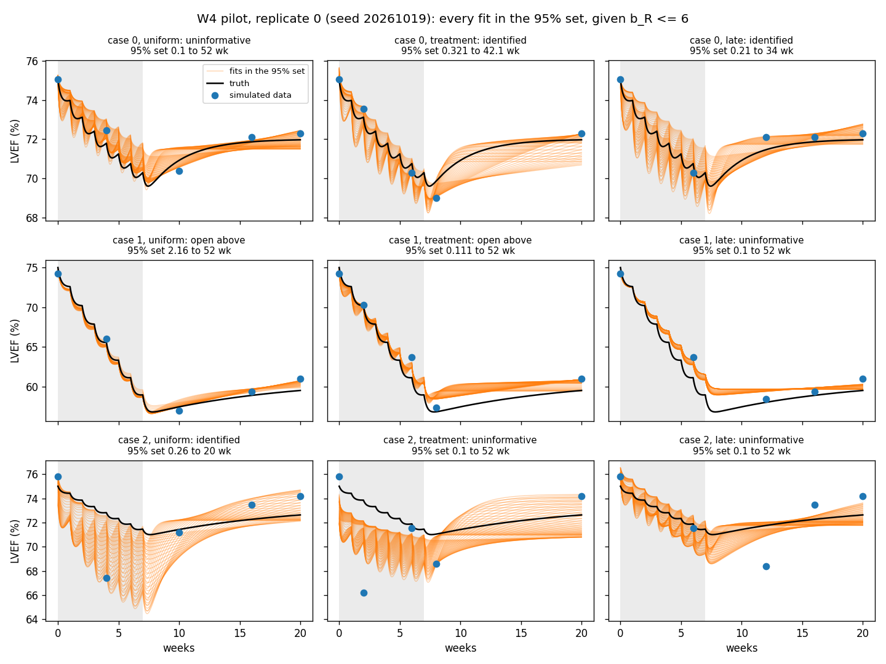

# Week 4 (Nov 9-13): pilot runs, seeds and failure logging

Owner: Xinan. My task from the proposal: configuration and seed tests, failure
logging, a short recorded walkthrough, and reviewing the fixed-schedule
comparison. The shared output for the week is a small schedule-comparison figure
and a tested code walkthrough, and the pilot stays at 3 scenarios by 3 fixed
schedules.

Two replies set how the runs get summarized:
- Nov 8: class counts, coverage, the width of the 95% set, and half-life error
  within the identified fits only; and a band of fitted curves instead of one
  fitted line.
- Nov 10: how to compute coverage, and what to do about the cap on b_R.

## Short version

- `src/doxo_lvef/evaluate.py` runs the pilot: 3 cases x 3 schedules x 20
  replicates, 180 fits on the plain grid. `python scripts/W4.py` runs it and
  writes the results to `outputs/`.
- Every (case, replicate) has its own random stream now, and the number of
  replicates is in `configs/pilot.toml`.
- Failed fits stay in as rows and go into their own file. None of
  the 180 fits failed.
- Coverage is 19 or 20 out of 20 in every cell (177 of 180 overall).
- 35 fits ended with b_R on the cap of 6. Refitting those with a cap of 12
  changed the class or the low end of the set in 12 of them.
- 195 tests, all passing (17 new). The W1, W2 and W3 outputs didn't change.

## How to run

```
python -m pytest            # all tests, about 25 seconds
python scripts/W4.py        # the pilot, a few seconds
```

`W4.py` writes four files:

| file | what's in it |
|---|---|
| `outputs/W4_fits.csv` | one row per fit, with the cap it was fitted with |
| `outputs/W4_failures.csv` | the failed fits (only the header right now) |
| `outputs/W4_summary.csv` | the summaries for each case and schedule |
| `outputs/W4_bands.png` | replicate 0: every fitted curve in the 95% set |

## Config and seeds

- The pilot reads everything from `configs/pilot.toml`: the cases, schedules,
  bounds, grid, the number of replicates (`[pilot] n_reps = 20`) and both caps on
  b_R. W1 still has its own 3 replicates.
- Each (case, replicate) gets its own stream:
  `np.random.default_rng([seed, case, replicate])`. In W1 one stream fed
  everything, so changing the number of replicates or a case moved everybody
  else's noise. Now it doesn't.
- The noise is drawn once on the baseline plus all nine candidate weeks, and each
  schedule picks its visits out of that. So the three schedules see the same
  noise at shared weeks (paired, as the proposal asks), and adding a schedule on
  the candidate grid changes nothing else.
- It's still the development seed. The final evaluation gets its own.

## The cap on b_R

6 is the declared cap for all pilot results (Nov 10). So everywhere in the
outputs, `identified` means identified given b_R <= 6.

- A fit that ends with b_R on the cap is fitted once more with a cap of 12
  (`b_R_refit_cap` in the config, never wider).
- Both results are kept as separate rows, and the `b_R_cap` column says which cap
  each row used, so the two runs can't be mixed up.
- The fit is `cap_dependent` if its class or the low end of its 95% set changed.
- The summaries only use the rows at the declared cap.

Why not just take the cap off: at short half-lives R follows the input, so with
a big enough b_R the model can reproduce any dip during dosing, and the low end
of the 95% set opens up.

## Coverage

`fit.covers_truth` follows the Nov 10 reply:

- It doesn't use the grid for the true value. It solves the bounded linear
  problem once more at the true half-life.
- The fit counts as covered if (RSS(h_true) - RSS_min)/sigma^2 <= 3.84.
- RSS_min is the refined minimum when the best grid point is interior, and the
  grid minimum when it's at the grid end.
- If RSS(h_true) is lower than RSS_min, it becomes the minimum, so the statistic
  is never negative.

With 20 replicates this is only a smoke test, so the table has counts, not
percentages. Formal coverage is spring work.

## What the pilot shows

From `outputs/W4_summary.csv`. Counts are out of 20 replicates. "Width" is the
median width of the 95% set in log2(half-life); the whole grid is 9.02. "Error"
is the median |log2(estimate / truth)| within the identified fits only.

| case | schedule | identified | open above | uninformative | covered | width | error (n) | on cap (cap-dependent) |
|---|---|---|---|---|---|---|---|---|
| 0 | uniform | 7 | 3 | 10 | 19 | 8.87 | 1.49 (7) | 5 (2) |
| 0 | treatment | 7 | 1 | 12 | 20 | 9.02 | 0.96 (7) | 3 (0) |
| 0 | late | 9 | 0 | 11 | 20 | 9.02 | 1.42 (9) | 2 (1) |
| 1 | uniform | 2 | 7 | 11 | 20 | 9.02 | 1.96 (2) | 2 (0) |
| 1 | treatment | 1 | 11 | 8 | 20 | 8.33 | 1.28 (1) | 2 (2) |
| 1 | late | 2 | 5 | 13 | 20 | 9.02 | 2.52 (2) | 1 (0) |
| 2 | uniform | 3 | 0 | 17 | 19 | 9.02 | 1.43 (3) | 5 (2) |
| 2 | treatment | 3 | 0 | 17 | 20 | 9.02 | 1.73 (3) | 10 (3) |
| 2 | late | 3 | 0 | 17 | 19 | 9.02 | 1.89 (3) | 5 (2) |

No fit was `open below`, and none of the 95% sets had a gap.

What I see:

- Most fits can't pin the half-life down: 116 of the 180 are `uninformative`, 27
  are `open above` and 37 are `identified`.
- `identified` doesn't mean precise. Even within the identified fits the
  half-life is typically off by a factor of 2 to 6.
- Case 1 (half-life 8 weeks, mostly persistent) is where `open above` shows up:
  slow recovery that the data can't tell from persistence.
- Case 2 (noise SD 3) is `uninformative` 17 times out of 20 on every schedule.
- Coverage is 19 or 20 of 20 everywhere, which is what a conservative 95% set
  should give.
- 12 of the 35 fits on the cap are cap-dependent, so the cap does matter for
  those, mostly through the low end of the set.

These are 20 replicates on the development seed, so I wouldn't rank the three
schedules from this table alone.

## Failure logging

A fit is failed if `lsq_linear` fails or gives a non-finite RSS at any grid
point. A failed fit keeps its row in `W4_fits.csv` with status `failed`, no
estimates, it's counted in the denominator, and it's also written to
`W4_failures.csv`. The summary has a `failed` count for every case and schedule.
bvls didn't fail on any of the 180 fits, so the tests make it fail on purpose.

## The figure



Replicate 0 of every case and schedule. The orange curves are the fits at every
grid half-life inside the 95% set. Where the set is the whole grid, like case 2
on the treatment and late schedules, very different curves all fit the five
points about equally well.

## The walkthrough

`docs/walkthrough.md` is the outline for the recorded walkthrough: what to run
and what each step shows. The commands in it are the ones `tests/test_scripts.py`
runs. The recording itself isn't done yet.

## The tests

`python -m pytest` runs 195 tests. The new ones:

- `test_evaluate.py` (11):
  - config: the replicates and both caps come from the config, and the runner
    follows a changed config;
  - seeds: same seed gives the same data, every (case, replicate) has its own
    stream, changing a case or the number of replicates leaves the others
    alone, and the schedules share their noise;
  - failures: failed fits stay in the denominator;
  - the cap refit, and the summaries on made-up rows.
- `test_fit.py` (+4): coverage on noiseless data, with the refined minimum, when
  the truth beats the minimum, and for a failed fit.
- `test_scripts.py` (+2): W4 runs and reproduces the committed results, also as a
  real `python scripts/W4.py` command.

## Still open

- The walkthrough still has to be recorded.
- I haven't reviewed the fixed-schedule comparison yet.
- The joint-session model notes (from Week 2) aren't written yet.

## Next (Week 5)

Freeze the tested pilot package, the unit tests, the config and the recorded
walkthrough, and fix whatever blocks the handoff.
